<h1 align="center">
  
</h1>

<p align="center">
  <a href="https://sakibtamim.vercel.app/"></a>
</p>

<p align="center">
  
  
  
  
</p>

<br/>

## 👨‍💻 About Me

```javascript
const sakibTamim = {
  role: "Software Engineer (Web)",
  company: "Purrfect Software Limited",
  location: "Dhaka, Bangladesh 🇧🇩",
  portfolio: "https://sakibtamim.vercel.app",
  code: ["TypeScript", "JavaScript", "SQL", "HTML5", "CSS3"],
  technologies: {
    frontEnd: {
      frameworks: ["React 19", "Next.js 15 (App Router)"],
      stateManagement: ["Zustand", "Redux Toolkit"],
      styling: ["Tailwind CSS v4", "shadcn/ui", "Framer Motion"],
    },
    backEnd: {
      frameworks: ["NestJS", "Node.js", "Fastify"],
      databases: ["PostgreSQL"],
      orm: ["Prisma", "Drizzle"],
    },
    aiVelocity: ["Google Gemini", "Claude", "ChatGPT", "GitHub Copilot", "Antigravity"],
    tools: ["Turborepo", "pnpm", "Git", "GitHub", "Figma"],
    testing: ["Vitest", "Playwright"],
    devOps: ["Docker", "Vercel", "Netlify"],
  },
  currentFocus: "Architecting high-performance enterprise web apps & healthcare SaaS",
  askMeAbout: ["Next.js", "React", "TypeScript", "Full-Stack Web", "Agentic SWE"],
  funFact: "I turn coffee ☕ into clean code 💻",
};
```

<br/>

<div align="center">
  
</div>

<br/>

<div align="center">

### 💼 Currently Working At

[](https://github.com/purrfectsoft)

</div>

---

## 🛠️ Tech Stack

<div align="center">

### Frontend Development


### Backend & Databases


### AI & Developer Velocity


### Styling & Design


### Tools & DevOps


</div>

---

## 🚀 Featured Projects

- **Motion Connect** — Healthcare & Rehabilitation SaaS Platform  
  *Tech Stack:* `Next.js 15` • `React 19` • `TypeScript` • `Tailwind CSS v4` • `shadcn/ui` • `Zustand` • `Zod` • `Turborepo`  
  *Engineered core administrative and clinical modules for a multi-tenant healthcare platform with type-safe state management.*

- **[Sunshine Physiotherapy](https://www.sunshineptc.com/)** — Clinical Care & Patient Triage Web Platform  
  *Tech Stack:* `Next.js (App Router)` • `React` • `TypeScript` • `Tailwind CSS` • `Drizzle ORM` • `PostgreSQL` • `Docker` • `Playwright`  
  *End-to-end patient triage and therapist appointment booking platform with automated Playwright testing.*

- **Motion Mechanics** — Corporate Healthcare Web Platform  
  *Tech Stack:* `Next.js` • `TypeScript` • `Tailwind CSS` • `Framer Motion` • `SEO Schema`  
  *Modern corporate healthcare platform featuring fluid animations, dynamic booking flows, and structured JSON-LD SEO schema.*

- **Purrfect Software Limited** — Corporate Portal & Technical Showcase  
  *Tech Stack:* `Next.js 15` • `React 19` • `TypeScript` • `Tailwind CSS` • `Turborepo`  
  *Official corporate web application and case study showcase architected in a Turborepo monorepo.*

- **[Jasper](https://github.com/sakibtamim/Jasper)** — High-Resilience Discord Streaming Engine  
  *Tech Stack:* `TypeScript` • `Node.js` • `Discord.js` • `yt-dlp` • `FFmpeg` • `Turborepo` • `Vitest`  
  *Open-source media streaming engine overcoming CDN rate limits with multi-guild queues and stream caching.*

- **[PurrTrack](https://github.com/sakibtamim/purrtrack)** — Enterprise Voice Activity Tracking & Analytics System  
  *Tech Stack:* `TypeScript` • `Discord.js` • `Fastify` • `Drizzle ORM` • `PostgreSQL` • `Vitest`  
  *Automated voice presence monitoring bot with relational PostgreSQL schemas and analytical reporting.*

---

## 📊 GitHub Analytics

<div align="center">
  <!-- Top Languages (Working) -->
  
</div>

<div align="center">
  <!-- Profile Trophy (Working) -->
  
</div>

<div align="center">
  
</div>

---

## 📈 Contribution Graph

<div align="center">

### 🐍 Snake Eating My Contributions


### 🎮 Pacman Eating My Contributions

<picture>
  <source media="(prefers-color-scheme: dark)" srcset="https://raw.githubusercontent.com/sakibtamim/sakibtamim/output/pacman-contribution-graph-dark.svg">
  <source media="(prefers-color-scheme: light)" srcset="https://raw.githubusercontent.com/sakibtamim/sakibtamim/output/pacman-contribution-graph.svg">
  
</picture>

</div>

---

## 💡 Quote of the Day

<div align="center">


</div>

---

## 🤝 Connect With Me

<div align="center">

[](https://sakibtamim.vercel.app/)
[](https://linkedin.com/in/sakibtamim)
[](https://github.com/sakibtamim)
[](mailto:sakib.tamim@gmail.com)

</div>

---

<div align="center">

### 💬 Ask Me About

**React** • **Next.js** • **TypeScript** • **Full-Stack Web** • **Turborepo** • **Healthcare SaaS**

### 📫 How to Reach Me

📧 **Email:** [sakib.tamim@gmail.com](mailto:sakib.tamim@gmail.com)  
🌐 **Portfolio:** [sakibtamim.vercel.app](https://sakibtamim.vercel.app/)

</div>

<div align="center">

---

<p align="center">
  
</p>

**⭐️ From [sakibtamim](https://github.com/sakibtamim) | Made with ❤️ and ☕**

</div>
